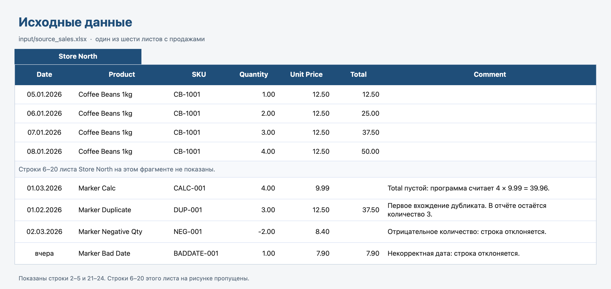
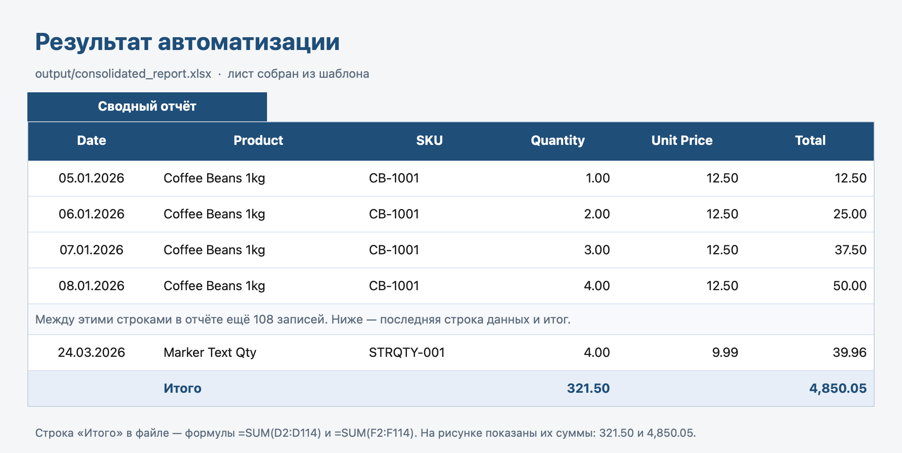

# Excel Automation

Учебный проект для портфолио. Программа собирает строки с нескольких листов одной книги Excel, проверяет их и записывает принятые строки в новый файл по готовому шаблону.

Это не коммерческий заказ и не система для реальных клиентских данных. Пример в `input/source_sales.xlsx` собран искусственно: названия товаров, артикулы и ошибочные строки нужны только для демонстрации и тестов.

## Задача

Нужно получить один отчёт из книги, где продажи лежат на разных листах. Повторный запуск строит файл заново по текущим исходным данным и не дописывает прошлый отчёт.

## Возможности

- Читает все листы, у которых в первой строке есть колонки Date, Product, SKU, Quantity, Unit Price и Total. Регистр заголовков не важен.
- Пропускает полностью пустые строки и строки из пробелов.
- Проверяет дату, название, артикул, количество, цену и Total.
- Считает Total как количество × цена, если ячейка пустая.
- Сверяет заполненный Total с расчётом. Допуск — 0.01.
- Принимает числа с точкой и с запятой, в том числе с разделителями тысяч.
- Находит дубликаты по сочетанию даты, артикула и названия. В отчёте остаётся первая принятая строка.
- Записывает результат в копию шаблона и сохраняет оформление шапки, ширину колонок и лист «Справка».
- Ведёт журнал `logs/app.log`.
- Не изменяет исходную книгу и файл шаблона.
- Запускается командой `python main.py`. Свой файл передаётся через `--input`.

## Технологии

- Python. В коде требуется версия 3.11 или новее. Полный набор тестов и запуск `main.py` проверены на Python 3.14.2 в macOS.
- openpyxl 3.1.5 для чтения и записи `.xlsx`.
- pytest 9.2.0 для автоматических тестов.
- Стандартные средства Python: `argparse`, `logging`, `decimal`, `pathlib`.

Другие библиотеки в код не импортируются. `et-xmlfile` ставится вместе с openpyxl.

## Структура проекта

```text
excel_automation/
├── main.py              # запуск и сводка на экране
├── config.py            # пути, колонки, допуск
├── processor.py         # проверка строк, числа, дубликаты
├── excel_handler.py     # чтение книги и запись по шаблону
├── logger.py            # журнал
├── sample_data.py       # заново создаёт учебный пример и шаблон
├── requirements.txt
├── pytest.ini
├── docs/
│   └── images/
│       ├── input-preview.png
│       └── report-preview.png
├── input/
│   └── source_sales.xlsx
├── templates/
│   └── report_template.xlsx
├── output/              # сюда сохраняется отчёт
├── logs/                # сюда пишется журнал
└── tests/
```

Папки `output` и `logs` в репозитории содержат только `.gitkeep`. Готовый отчёт и журнал создаются при запуске и в Git не входят.

## Требования

- Python 3.11 или новее. На этой машине использовался Python 3.14.2.
- Возможность создать виртуальное окружение и установить пакеты из `requirements.txt`.
- Для просмотра отчёта подойдёт Excel или другая программа, которая открывает `.xlsx`.

Команды ниже проверены в macOS, в оболочке zsh. Запуск на Windows в этом окружении не проверялся.

## Установка

В терминале перейдите в каталог проекта:

```bash
cd excel_automation
python3 -m venv .venv
source .venv/bin/activate
python -m pip install -r requirements.txt
```

После активации в начале строки появляется `(.venv)`. Дальше команды выполняются в этом же окне.

## Запуск

Учебный пример:

```bash
python main.py
```

Программа читает `input/source_sales.xlsx`, берёт оформление из `templates/report_template.xlsx` и сохраняет `output/consolidated_report.xlsx`. Журнал: `logs/app.log`.

Свой файл:

```bash
python main.py --input "/путь/к/файлу.xlsx"
```

Шаблон, отчёт и журнал можно указать отдельно:

```bash
python main.py --input "/путь/к/файлу.xlsx" --template "/путь/к/шаблону.xlsx" --output "/путь/к/отчёту.xlsx" --log "/путь/к/журналу.log"
```

В первой строке листа с данными должны быть колонки Date, Product, SKU, Quantity, Unit Price и Total. Лист без этих заголовков пропускается. Если часть заголовков есть, а обязательной колонки нет, лист пропускается с записью в журнал.

Учебные файлы можно собрать заново:

```bash
python sample_data.py
```

Эта команда перезаписывает `input/source_sales.xlsx` и `templates/report_template.xlsx`. Уже созданный отчёт она не удаляет.

## Тесты

Из каталога `excel_automation` при активном окружении:

```bash
python -m pytest
```

Тесты читают настоящие книги Excel: проверяют ячейки, расчёт Total, дубликаты, повторный запуск и оформление шаблона. Для них нужны файлы `input/source_sales.xlsx` и `templates/report_template.xlsx`.

## Пример результата

Фрагменты собраны из учебных книг. На рисунках только заголовки и несколько строк, не вся таблица.



Исходные данные. Это лист Store North из `input/source_sales.xlsx`.



Результат автоматизации. Это лист «Сводный отчёт» из `output/consolidated_report.xlsx`. В файле строка «Итого» хранит формулы. На рисунке показаны их суммы: количество 321.50 и Total 4,850.05.

На учебном файле программа печатает:

```text
Обработка завершена.
Листов с данными            6
Прочитано строк             128
Успешно обработано          113
Пропущено записей           12
Обнаружено дубликатов       3
Пустых строк пропущено      3
Листов с ошибкой структуры  1
```

Отчёт лежит в `output/consolidated_report.xlsx`, лист «Сводный отчёт». Под данными есть строка «Итого» с формулами Excel. Второй запуск по тем же данным снова даёт 113 записей и не добавляет дубликаты.

В журнале строка выглядит так:

```text
2026-11-10 18:40:00 | WARNING | Лист «Store North», строка 24: отрицательное количество: -2
```

WARNING — пропущенная строка или дубликат. ERROR — проблема файла или целого листа. Пустые строки в журнал как ошибки не пишутся.

Числа в тексте читаются по фиксированным правилам:

- `1234.56` и `1234,56` — одно и то же значение;
- если есть и точка, и запятая, десятичный знак стоит правее: `1,234.56` и `1.234,56`;
- пробел, в том числе неразрывный, отделяет тысячи: `1 234,56`;
- одна точка или одна запятая — всегда десятичный знак, поэтому `1,234` означает 1.234, а не 1234;
- `abc` и `1,23,45` не превращаются в ноль: строка пропускается;
- отрицательное количество или цена распознаются и тоже пропускаются.

## Ограничения

- Заголовки должны быть в первой строке листа.
- Формулы в исходных ячейках не вычисляются. Нужны уже записанные значения.
- Поддерживается только `.xlsx`. Формат `.xls` и зашифрованные книги не открываются.
- Дубликат зависит от регистра названия и артикула.
- Дата вида `15/03/2026` читается как день/месяц/год. Год принимается с 1900 по 2100.
- Количество округляется до 4 знаков, цена и Total — до 2 знаков. Ноль допускается.
- Суммы в строке «Итого» — формулы. Они видны после открытия файла в Excel.
- Проект проверялся на macOS. Поведение в других системах отдельно не подтверждалось.
